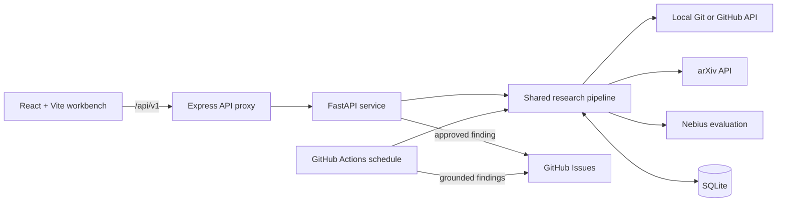

# Relevance

> The research that matters finds you.

Relevance is a research companion for software teams. It analyses a GitHub repository at an exact commit, retrieves recent academic papers from arXiv, evaluates which papers may matter to specific source files, and turns the strongest matches into reviewable findings. Developers can inspect those findings in a local web workbench, save or dismiss them, and publish an approved finding as a real GitHub issue.

The project was built for the Edinburgh AI Hackathon under the theme **Flip the Script**: instead of requiring developers to repeatedly search for applicable research, Relevance brings relevant work into the development workflow.

## Table of contents

- [What Relevance does](#what-relevance-does)
- [Current implementation](#current-implementation)
- [Architecture](#architecture)
- [How a scan works](#how-a-scan-works)
- [Technology stack](#technology-stack)
- [Repository structure](#repository-structure)
- [Prerequisites](#prerequisites)
- [Quick start](#quick-start)
- [Configuration](#configuration)
- [Running the services separately](#running-the-services-separately)
- [Using the web application](#using-the-web-application)
- [API reference](#api-reference)
- [Complete API walkthrough](#complete-api-walkthrough)
- [Repository ingestion](#repository-ingestion)
- [Paper matching and evaluation](#paper-matching-and-evaluation)
- [Persistence and data model](#persistence-and-data-model)
- [GitHub issue publication](#github-issue-publication)
- [Scheduled scans with GitHub Actions](#scheduled-scans-with-github-actions)
- [Validation and tests](#validation-and-tests)
- [Troubleshooting](#troubleshooting)
- [Security and trust boundaries](#security-and-trust-boundaries)
- [Known limitations](#known-limitations)
- [Contributing](#contributing)
- [Team](#team)

## What Relevance does

Relevance provides one shared research pipeline with two surfaces:

1. A local web application for selecting repositories, starting scans, reviewing evidence, managing findings, and approving GitHub publication.
2. A scheduled GitHub Actions job that runs the same pipeline against the repository and publishes grounded findings as issues.

The working end-to-end path is:

1. Add a repository as `owner/repository` and select a Git ref.
2. Resolve that ref to an exact commit SHA.
3. Read a bounded set of committed documentation, dependency manifests, and source files.
4. Build a project profile from the repository snapshot.
5. Fetch recent paper metadata and abstracts from the public arXiv API.
6. Shortlist papers using terms from the project profile.
7. Ask Nebius to evaluate the shortlisted abstracts against the repository snapshot.
8. Reject results that are weak, malformed, or do not cite a real file from the snapshot.
9. Store the scan, profile, papers, and findings in SQLite.
10. Review the findings in the browser and optionally publish one as a GitHub issue.

Each finding keeps the paper's reported content separate from Relevance's inference about the repository. A finding includes the arXiv source, affected files, excerpts from the analysed commit, a qualified match label, and a concrete experiment a developer can run.

## Current implementation

The repository currently supports:

- real public arXiv metadata and abstracts;
- repository ingestion from a local Git checkout or the GitHub REST API;
- exact-commit analysis rather than analysis of a moving branch;
- repository-aware evaluation through Nebius using `meta-llama/Llama-3.3-70B-Instruct`;
- grounding checks that only accept affected file paths present in the analysed snapshot;
- evidence labels of `Strong match`, `Worth reviewing`, and `Exploratory`;
- durable repositories, scans, project profiles, papers, findings, and publication state in SQLite;
- finding states of `new`, `saved`, and `dismissed`;
- real GitHub issue creation with duplicate-publication protection;
- a responsive React workbench with overview, discoveries, evidence, and repository controls;
- a daily and manually dispatchable GitHub Actions workflow;
- typed FastAPI contracts and generated OpenAPI documentation.

Relevance does **not** claim that it read a full paper when only the arXiv abstract was supplied, that a paper's results are correct, or that a suggested change will improve the repository. Findings are hypotheses for developer review and validation.

## Architecture



During local development, the browser uses the following request path:

```text
http://localhost:5173/api/v1/...
        │ Vite development proxy
        ▼
http://localhost:3001/api/v1/...
        │ Express upstream proxy
        ▼
http://localhost:8000/api/v1/...
        │ FastAPI service
        ▼
SQLite + repository/arXiv/Nebius/GitHub integrations
```

The Express service keeps the bot API URL and upstream timeout out of the browser bundle. Secrets are read only by server-side Python processes.

## How a scan works

A scan stores progress metadata and has one of four statuses: `queued`, `running`, `completed`, or `failed`.

```text
POST /api/v1/scans
        │
        ▼
      queued
        │ first GET /api/v1/scans/{id}
        ▼
      running ── reads repository, fetches arXiv, evaluates, stores results
        │ second GET /api/v1/scans/{id}
        ├───────────────────────────────┐
        ▼                               ▼
    completed                         failed
        │
        ▼
GET /api/v1/scans/{id}/findings
```

The local MVP is deliberately poll-driven and uses no task queue. Creating a scan stores it as `queued`. The first status request changes it to `running`; the next status request performs the synchronous pipeline work and returns the final state. The web application handles this polling automatically. API clients must poll as shown in the walkthrough below.

Only one queued or running scan may exist for a repository at a time. A duplicate request returns HTTP `409`.

## Technology stack

| Area | Technology | Purpose |
| --- | --- | --- |
| Frontend | React 19, TypeScript, Vite | Local research workbench |
| Web server | Express 5, TypeScript | Browser-facing API proxy |
| Bot API | FastAPI, Pydantic, Uvicorn | Typed HTTP contract and orchestration |
| Persistence | SQLite in WAL mode | Shared local state |
| Repository access | Local Git CLI or GitHub REST API | Exact-commit source snapshots |
| Research source | arXiv Atom API | Paper metadata and abstracts |
| Evaluation | Nebius Token Factory API | Code-aware structured evaluation |
| Publication | GitHub REST API | Real GitHub issues |
| Automation | GitHub Actions | Daily or manually dispatched scans |
| Tests | pytest and FastAPI TestClient | API, ingestion, evaluation, and workflow coverage |

## Repository structure

```text
.
├── .github/
│   ├── relevance.yml              # Scheduled scan categories and limits
│   └── workflows/relevance.yml    # Daily/manual GitHub Actions workflow
├── bot/
│   ├── app/
│   │   ├── arxiv.py               # arXiv request and Atom parsing
│   │   ├── daily.py               # GitHub Actions entry point
│   │   ├── evaluation.py          # Shortlisting and Nebius evaluation
│   │   ├── main.py                # FastAPI application and routes
│   │   ├── models.py              # Pydantic API/domain models
│   │   ├── pipeline.py            # Shared repository-to-finding pipeline
│   │   ├── publishing.py          # Idempotent GitHub issue publication
│   │   ├── repository.py          # Local/GitHub repository ingestion
│   │   ├── service.py             # Scan lifecycle and application service
│   │   └── storage.py             # SQLite schema and persistence
│   ├── tests/                     # Python test suite
│   ├── requirements.txt           # Runtime Python dependencies
│   └── requirements-dev.txt       # Runtime plus test dependencies
├── web/
│   ├── backend/                   # Express proxy
│   ├── frontend/                  # React application
│   ├── .env.example               # Express configuration example
│   ├── package.json               # Workspace scripts
│   └── package-lock.json          # Reproducible npm dependency graph
├── AGENTS.md                      # Team workflow and product UI guidance
├── brief.md                       # Original product plan
└── README.md                      # This guide
```

## Prerequisites

Install the following before starting:

- **Python 3.11 or newer**;
- **Node.js 20.19 or newer, or Node.js 22.12 or newer** (the requirement declared by Vite 7);
- **npm 10 or newer**;
- **Git**;
- outbound HTTPS access to GitHub, `export.arxiv.org`, and the configured Nebius endpoint;
- a Nebius API key for live repository-aware scans;
- optionally, a GitHub token for private repositories and issue publication.

The application can add and inspect a public GitHub repository without a token, subject to GitHub's unauthenticated rate limits. A scan still requires `NEBIUS_API_KEY` because there is no silent mock evaluation path.

## Quick start

### 1. Clone and enter the repository

```bash
git clone <repository-url>
cd SweetHomeAlabama256
```

### 2. Create the Python environment

From the repository root:

```bash
python3 -m venv bot/.venv
bot/.venv/bin/python -m pip install --upgrade pip
bot/.venv/bin/python -m pip install -r bot/requirements-dev.txt
```

The combined development command expects the interpreter at `bot/.venv/bin/python`, so keep this location unless you intend to run the services separately.

### 3. Install the web dependencies

```bash
cd web
npm install
cd ..
```

`npm install` uses the committed lockfile and installs both npm workspaces: `web/frontend` and `web/backend`.

### 4. Export the required credentials

At minimum, export a Nebius key in the terminal that will start the services:

```bash
export NEBIUS_API_KEY="your-nebius-api-key"
```

For private repository access and GitHub issue publication, also export a token:

```bash
export GITHUB_TOKEN="your-github-token"
```

Do not commit either value. Files ending in `.env` are ignored, but the current processes read the shell environment directly; `web/.env.example` is a reference file and is not automatically loaded by the Express process.

When analysing this checkout locally, point Relevance at it:

```bash
export RELEVANCE_REPOSITORY_ROOT="$(pwd)"
```

Local ingestion is used only when the selected repository name matches the checkout directory name. For this checkout, add a repository whose name is `SweetHomeAlabama256`.

### 5. Start all three services

```bash
cd web
npm run dev
```

This command starts:

| Service | Address | Notes |
| --- | --- | --- |
| React frontend | <http://localhost:5173> | Main user interface |
| Express proxy | <http://localhost:3001> | Browser-facing API proxy |
| FastAPI bot | <http://localhost:8000> | Research and persistence API |
| Swagger UI | <http://localhost:8000/docs> | Interactive API documentation |
| OpenAPI JSON | <http://localhost:8000/openapi.json> | Machine-readable contract |

Open <http://localhost:5173> and follow the [golden path](#golden-path-for-the-demo).

## Configuration

All configuration is provided through environment variables except the scheduled workflow's paper categories and result limit, which live in `.github/relevance.yml`.

### Research and repository service

| Variable | Required | Default | Description |
| --- | --- | --- | --- |
| `NEBIUS_API_KEY` | For scans | None | Authenticates repository-aware evaluation. A scan fails clearly when it is absent. |
| `NEBIUS_BASE_URL` | No | `https://api.tokenfactory.nebius.com/v1` | Overrides the OpenAI-compatible Nebius base URL. |
| `GITHUB_TOKEN` | For private repositories and publishing | None | Authenticates GitHub repository reads and issue creation. Its presence also marks repository connections as GitHub-connected in the UI. |
| `RELEVANCE_DB_PATH` | No | `bot/relevance.db` | SQLite database path. Parent directories are created automatically. |
| `RELEVANCE_REPOSITORY_ROOT` | No | Auto-detected project root | Local Git checkout to use when its directory name matches the selected repository name. |
| `RELEVANCE_ARXIV_CATEGORIES` | No | `cs.AI,cs.LG,cs.CL` | Comma-separated arXiv categories used by API-triggered scans. |
| `RELEVANCE_ARXIV_MAX_RESULTS` | No | `5` | Number of recent arXiv results to request; accepted range is 1–25. |
| `RELEVANCE_ARXIV_TIMEOUT_SECONDS` | No | `10` | arXiv request timeout in seconds; accepted range is 1–60. |
| `RELEVANCE_CORS_ORIGINS` | No | `http://localhost:3000,http://localhost:5173` | Comma-separated exact origins accepted by FastAPI. Set an empty value to omit CORS middleware. |

Example development configuration:

```bash
export NEBIUS_API_KEY="your-nebius-api-key"
export GITHUB_TOKEN="your-github-token"
export RELEVANCE_REPOSITORY_ROOT="$(pwd)"
export RELEVANCE_DB_PATH="$(pwd)/bot/relevance.db"
export RELEVANCE_ARXIV_CATEGORIES="cs.AI,cs.LG,cs.CL,cs.SE"
export RELEVANCE_ARXIV_MAX_RESULTS=8
```

### Express proxy

| Variable | Required | Default | Description |
| --- | --- | --- | --- |
| `BOT_API_URL` | No | `http://localhost:8000` | Base URL used by Express to reach FastAPI. Only HTTP and HTTPS URLs are accepted. |
| `BOT_API_TIMEOUT_MS` | No | `75000` | Upstream request timeout. Must be an integer from 1 to 120000. |
| `PORT` | No | `3001` | Express listen port. Must be an integer from 1 to 65535. |

The browser client has its own 90-second request timeout. If you raise the arXiv timeout, keep the Express timeout and browser limit in mind.

### GitHub Actions environment

GitHub supplies these values to the scheduled entry point:

| Variable | Source | Purpose |
| --- | --- | --- |
| `GITHUB_REPOSITORY` | GitHub Actions | Repository in `owner/repository` form |
| `GITHUB_SHA` | GitHub Actions | Exact checked-out commit to analyse |
| `GITHUB_WORKSPACE` | GitHub Actions | Local checkout used for ingestion and configuration |
| `GITHUB_TOKEN` | Workflow secret context | Reads repository data and writes issues |
| `NEBIUS_API_KEY` | Repository Actions secret | Evaluates paper-to-code matches |

## Running the services separately

Running each process in its own terminal is useful when debugging request flow or server logs.

From the repository root, start FastAPI:

```bash
bot/.venv/bin/python -m uvicorn app.main:app \
  --app-dir bot \
  --reload \
  --port 8000
```

In a second terminal, start Express:

```bash
cd web
npm run dev:backend
```

In a third terminal, start Vite:

```bash
cd web
npm run dev:frontend
```

The convenience scripts available from `web/` are:

| Command | Effect |
| --- | --- |
| `npm run dev` | Starts frontend, Express, and FastAPI together |
| `npm run dev:frontend` | Starts only Vite on port 5173 |
| `npm run dev:backend` | Starts only Express on port 3001 |
| `npm run dev:bot` | Starts only FastAPI on port 8000 using `bot/.venv` |
| `npm run typecheck` | Type-checks both TypeScript workspaces |
| `npm run build` | Builds the frontend and Express server |

Starting only Vite leaves its `/api` proxy without the Express process, so the interface will report that the bot API is unavailable.

## Using the web application

### Golden path for the demo

1. Open <http://localhost:5173>.
2. Select **Repositories** in the left navigation.
3. Enter a repository as `owner/repository` or a full `https://github.com/owner/repository` URL.
4. Enter a branch, tag, or commit SHA such as `main`.
5. Select **Add repository**. This stores and selects the repository; it does not run a scan.
6. Select **Run scan** from the top bar or overview.
7. Watch the truthful scan state move from queued to repository/paper evaluation and then complete.
8. Open **Discoveries** and select **View evidence** on a finding.
9. Compare the paper summary, which is source material, with **Why Relevance flagged it**, which is a model inference.
10. Inspect the affected file excerpt and suggested experiment.
11. Save or dismiss the finding. Dismissed findings remain available through the status filter.
12. If `GITHUB_TOKEN` is configured, select **Create GitHub issue**, confirm publication, and follow **Open on GitHub**.

### Available views

- **Overview** shows the selected repository, latest known analysis state, finding count, and quick access to recent findings.
- **Discoveries** supports text search plus source, severity, publication date, and user-status filters. Finding evidence expands inline.
- **Repositories** adds and selects repositories and displays local preference controls.

The monitoring interval, topic toggles, and threshold shown under **Repositories** are browser-local preferences in the current MVP. They do not configure a background worker or alter API-side finding generation. Scheduled automation is handled separately by GitHub Actions.

## API reference

The canonical live contract is available from FastAPI at <http://localhost:8000/openapi.json>. Swagger UI at <http://localhost:8000/docs> can execute each request interactively.

| Method | Path | Success | Behaviour |
| --- | --- | --- | --- |
| `GET` | `/health` | `200` | Reports API health plus GitHub and Nebius configuration flags. |
| `GET` | `/api/v1/repositories` | `200` | Lists persisted repository connections. |
| `POST` | `/api/v1/repositories` | `201` | Adds or updates a repository connection. |
| `GET` | `/api/v1/repositories/{owner}/{repo}/profile` | `200` | Returns the latest stored project profile; returns `404` before a successful scan. |
| `POST` | `/api/v1/scans` | `202` | Queues a scan; returns `409` if that repository already has an active scan. |
| `GET` | `/api/v1/scans/{scan_id}` | `200` | Reads and advances the poll-driven scan lifecycle. |
| `GET` | `/api/v1/scans/{scan_id}/findings` | `200` | Returns findings for a completed scan; returns `409` while incomplete. |
| `GET` | `/api/v1/repositories/{owner}/{repo}/findings` | `200` | Returns persisted findings for a repository, newest first. |
| `PATCH` | `/api/v1/findings/{finding_id}` | `200` | Sets `user_status` to `new`, `saved`, or `dismissed`. |
| `POST` | `/api/v1/findings/{finding_id}/issues` | `200` | Publishes an approved finding to GitHub, idempotently. |

Browser requests use the same paths through Express. Express also exposes `GET /api/health` for its own process health; this route is distinct from FastAPI's `GET /health`.

### Core request shapes

Repository requests use:

```json
{
  "repository": {
    "owner": "octo-org",
    "repo": "demo-repo",
    "ref": "main"
  }
}
```

The owner and repository names are validated. Do not include a `.git` suffix. `ref` may be a branch, tag, or commit accepted by Git/GitHub.

Finding status updates use:

```json
{
  "status": "saved"
}
```

Issue publication requires explicit approval in the request schema:

```json
{
  "approved": true
}
```

## Complete API walkthrough

The examples below talk directly to FastAPI. They use `python3` only to extract identifiers from JSON, avoiding a dependency on `jq`.

### 1. Check configuration

```bash
curl --fail --silent http://localhost:8000/health | python3 -m json.tool
```

Expected fields include:

```json
{
  "status": "ok",
  "service": "relevance-bot-api",
  "github_connected": true,
  "evaluation_configured": true
}
```

The booleans report whether the corresponding environment variables are present. They do not make a network request to validate the credentials.

### 2. Add a repository

```bash
curl --fail --silent \
  -X POST http://localhost:8000/api/v1/repositories \
  -H 'Content-Type: application/json' \
  -d '{"repository":{"owner":"octo-org","repo":"demo-repo","ref":"main"}}' \
  | python3 -m json.tool
```

### 3. Start a scan

```bash
SCAN_RESPONSE=$(curl --fail --silent \
  -X POST http://localhost:8000/api/v1/scans \
  -H 'Content-Type: application/json' \
  -d '{"repository":{"owner":"octo-org","repo":"demo-repo","ref":"main"}}')

SCAN_ID=$(printf '%s' "$SCAN_RESPONSE" | python3 -c 'import json,sys; print(json.load(sys.stdin)["id"])')
printf 'Scan ID: %s\n' "$SCAN_ID"
```

### 4. Advance the scan to running

```bash
curl --fail --silent \
  "http://localhost:8000/api/v1/scans/$SCAN_ID" \
  | python3 -m json.tool
```

The response should now report `"status": "running"`.

### 5. Run the synchronous pipeline

```bash
curl --fail --silent \
  "http://localhost:8000/api/v1/scans/$SCAN_ID" \
  | python3 -m json.tool
```

This request can take roughly as long as the repository, arXiv, and Nebius network calls. It returns `completed` with an `analysed_sha`, or `failed` with a safe error message.

### 6. Read the findings

```bash
FINDINGS_RESPONSE=$(curl --fail --silent \
  "http://localhost:8000/api/v1/scans/$SCAN_ID/findings")

printf '%s' "$FINDINGS_RESPONSE" | python3 -m json.tool
FINDING_ID=$(printf '%s' "$FINDINGS_RESPONSE" | python3 -c 'import json,sys; print(json.load(sys.stdin)["findings"][0]["id"])')
```

A valid scan may return zero findings when no candidate passes the grounding and confidence checks. In that case there is no finding ID to save or publish.

### 7. Save a finding

```bash
curl --fail --silent \
  -X PATCH "http://localhost:8000/api/v1/findings/$FINDING_ID" \
  -H 'Content-Type: application/json' \
  -d '{"status":"saved"}' \
  | python3 -m json.tool
```

### 8. Publish a finding to GitHub

This operation creates an external GitHub issue and requires `GITHUB_TOKEN`:

```bash
curl --fail --silent \
  -X POST "http://localhost:8000/api/v1/findings/$FINDING_ID/issues" \
  -H 'Content-Type: application/json' \
  -d '{"approved":true}' \
  | python3 -m json.tool
```

Repeating the request returns the already stored or discovered issue instead of intentionally creating a duplicate.

## Repository ingestion

Relevance has two ingestion paths.

### Local Git checkout

The local path is chosen when:

- `RELEVANCE_REPOSITORY_ROOT` points to a Git checkout whose directory name matches the selected repository name; or
- the project root is itself a matching Git checkout.

The selected ref is resolved with Git to an exact commit. Files are read with `git show <sha>:<path>`, so uncommitted working-tree changes are deliberately excluded. This makes every finding reproducible against its stored `analysed_sha`.

### GitHub REST API

When no matching local checkout exists, Relevance:

1. resolves the requested ref through the commits API;
2. requests the recursive Git tree at that SHA;
3. reads the selected files at the same SHA;
4. collects up to five recent commit subjects;
5. collects up to ten open issues, excluding pull requests.

Public repositories may be read without authentication. Private repositories require `GITHUB_TOKEN` with access to their contents and metadata.

### Snapshot limits

Repository input is intentionally bounded for cost, latency, and prompt size:

| Limit | Current value |
| --- | --- |
| Dependency/documentation manifests | Up to 10 |
| Source files | Up to 16 |
| Characters read per file | 8,000 |
| Total repository context | Approximately 80,000 characters |
| Recent commits | Up to 5 |
| Open GitHub issues | Up to 10 |

Common generated or dependency directories such as `.git`, `node_modules`, `vendor`, `dist`, `build`, virtual environments, caches, and coverage output are ignored. Hidden path components are also excluded.

The source-file selection currently favours supported files nearer the repository root. Supported languages include Python, TypeScript, JavaScript, Rust, Go, Java, Kotlin, C/C++, C#, Ruby, PHP, Swift, Scala, and SQL.

## Paper matching and evaluation

API-triggered scans request the newest papers from the configured arXiv categories. The default query covers `cs.AI`, `cs.LG`, and `cs.CL` and requests five results.

The pipeline then:

1. derives terms from the project summary, methods, and research topics;
2. ranks paper titles and abstracts by lexical overlap, weighting title matches more heavily;
3. sends at most ten shortlisted abstracts to Nebius with the bounded repository context;
4. asks for structured JSON containing a finding type, repository-specific explanation, exact affected paths, suggested experiment, and confidence value;
5. validates the response before creating findings.

A proposed finding is rejected unless:

- its paper identifier was present in the input;
- its finding type is one of `potential_improvement`, `challenges_assumption`, or `new_technique`;
- confidence is between `0.70` and `1.00`;
- it cites at least one exact file path present in the repository snapshot;
- its repository explanation and suggested action contain substantive text.

Accepted confidence values are presented as qualitative review labels:

| Model score | Evidence label | Relevance | Severity |
| --- | --- | --- | --- |
| `0.85`–`1.00` | Strong match | High | Medium |
| `0.75`–`0.849…` | Worth reviewing | Medium | Low |
| `0.70`–`0.749…` | Exploratory | Low | Info |

These values are model ranking scores, not measured probabilities that a finding is correct.

## Persistence and data model

SQLite is the shared source of truth for API-triggered and scheduled scans. The default database is `bot/relevance.db`; it is ignored by Git and created on first use.

The schema stores:

- connected repositories and their latest analysed SHA;
- generated project profiles;
- queued, running, completed, and failed scans;
- arXiv paper metadata and abstracts;
- repository-specific findings;
- links between scans and findings;
- processed paper identifiers;
- finding user status and GitHub issue state;
- a table reserved for monitoring preferences.

SQLite uses foreign keys and WAL journalling. The API is designed for a single local process in this MVP; do not start multiple FastAPI workers against the same scan lifecycle and expect distributed job coordination.

Finding IDs are deterministic for a repository, analysed commit, and paper identifier. Re-evaluating the same paper at the same commit preserves its saved/dismissed state and previously created issue record.

To use a disposable database for an isolated run:

```bash
export RELEVANCE_DB_PATH="$(mktemp -d)/relevance.db"
cd web
npm run dev
```

## GitHub issue publication

Publication is explicit in the web application and API. Relevance creates an issue containing:

- an invisible finding marker used for duplicate detection;
- the paper title, arXiv link, and identifier;
- the paper summary under **What the paper reports**;
- the inferred repository connection under **Possible application to this repository**;
- the analysed commit SHA;
- affected paths and stored source excerpts;
- a suggested experiment;
- a notice explaining that the connection is a model inference and that Relevance did not validate the paper's results.

Before creating an issue, the publisher searches existing issues for the finding marker. Local issue state is also checked first, so retries are idempotent in the ordinary demo path.

For a fine-grained GitHub token, grant repository access only to the repositories Relevance needs and allow:

- repository metadata read access;
- repository contents read access;
- issues read and write access.

The UI considers GitHub connected when `GITHUB_TOKEN` is present. Credential validity and repository permissions are verified only when a GitHub request is made.

## Scheduled scans with GitHub Actions

The workflow at `.github/workflows/relevance.yml` runs every day at `08:17 UTC` and can also be started from **Actions → Relevance daily research scan → Run workflow**.

The workflow:

1. checks out the repository;
2. installs Python 3.12 and runtime dependencies;
3. loads categories and limits from `.github/relevance.yml`;
4. analyses the exact `GITHUB_SHA` from the local checkout;
5. evaluates recent arXiv abstracts through Nebius;
6. writes the local SQLite records for the duration of the job;
7. publishes each accepted finding as an idempotent GitHub issue.

The committed configuration currently requests up to ten papers from `cs.AI`, `cs.LG`, and `cs.CL`, and limits a run to three findings.

To enable the workflow:

1. Open the repository's **Settings → Secrets and variables → Actions**.
2. Add a repository secret named `NEBIUS_API_KEY`.
3. Confirm that Actions are enabled.
4. Confirm the workflow has write access to issues. The workflow declares `contents: read` and `issues: write` permissions.
5. Run it manually once and inspect both the job log and any generated issue.

The workflow uses GitHub's built-in `GITHUB_TOKEN`; no personal access token needs to be stored for it. The SQLite file created on a hosted runner is ephemeral, while duplicate issue protection also uses the marker already present in GitHub issues.

## Validation and tests

### Python tests

From the repository root:

```bash
cd bot
.venv/bin/python -m pytest -q
```

The suite covers the HTTP contract, scan lifecycle, SQLite persistence, arXiv parsing and errors, evaluation validation, exact-commit local ingestion, status changes, and idempotent issue publication with test doubles. It does not publish a real GitHub issue or spend Nebius credits.

### TypeScript checks and production build

```bash
cd web
npm run typecheck
npm run build
```

The production frontend output is written to `web/frontend/dist`, and the compiled Express server is written to `web/backend/dist`.

Run the compiled Express service with:

```bash
cd web
npm run start --workspace backend
```

This starts the API proxy only. A production deployment must serve the frontend build separately and provide a reachable FastAPI service through `BOT_API_URL`.

### Manual end-to-end check

1. Start all services with valid Nebius credentials.
2. Add a real public repository.
3. Run a scan and confirm it records an exact SHA.
4. Confirm every affected-file link uses that analysed revision.
5. Open the cited arXiv page and compare it with the displayed source summary.
6. Save and dismiss findings, then recover the dismissed one with the status filter.
7. With an authorised test repository and `GITHUB_TOKEN`, publish one finding.
8. Open the resulting issue and confirm its paper link, commit, paths, excerpts, and qualification notice.
9. Repeat publication and confirm a second issue is not created.

## Troubleshooting

### `NEBIUS_API_KEY is required to evaluate repository-aware findings`

Export `NEBIUS_API_KEY` in the same shell before running `npm run dev`. Restart the combined process after changing environment variables.

### `The bot API is unavailable`

Check each health endpoint:

```bash
curl --fail http://localhost:3001/api/health
curl --fail http://localhost:8000/health
```

If Express is healthy but FastAPI is not, confirm `bot/.venv` exists and contains the requirements. If FastAPI is on another host or port, set `BOT_API_URL` before starting Express.

### A scan stays queued or running

Scans advance through status polling. The web application polls automatically. A direct API client must call `GET /api/v1/scans/{id}` once to enter `running` and again to execute the pipeline.

If a process stopped while a scan was queued or running, that persisted scan can block a duplicate scan for the same repository. Inspect it through the scan endpoint and allow the request to advance or fail before creating another scan.

### `A scan for owner/repository is already active`

An existing scan is `queued` or `running`. Continue polling its ID. The API intentionally prevents duplicate concurrent work for the same repository.

### GitHub reports that the repository cannot be read

Check the owner, repository, and ref. For a private repository, ensure `GITHUB_TOKEN` can read its metadata and contents. For local ingestion, confirm `RELEVANCE_REPOSITORY_ROOT` is a Git checkout and its directory name matches the repository name entered in the UI.

### Local changes are missing from the analysis

This is expected. Local ingestion reads the exact committed object with `git show`; it does not read uncommitted working-tree content. Commit the intended changes on an appropriate branch and scan that branch or commit SHA.

### GitHub is shown as connected but publication fails

The connection flag checks only whether `GITHUB_TOKEN` exists. Confirm the token is valid, has access to the selected repository, and can read and write issues.

### arXiv times out

Confirm outbound access to `https://export.arxiv.org`. Increase `RELEVANCE_ARXIV_TIMEOUT_SECONDS` up to 60 if necessary, while keeping `BOT_API_TIMEOUT_MS` below its maximum and within the browser's 90-second request limit.

### A successful scan returns no findings

This is a valid result. Candidates are omitted when the model finds no sufficiently specific connection, confidence is below `0.70`, affected paths do not match the supplied snapshot, or the response fails structural validation.

### Ports 5173, 3001, or 8000 are already in use

- Vite will normally offer a nearby port, but FastAPI's default CORS list may then need the new origin.
- Change Express with `PORT`, and update Vite's development proxy if you change port 3001.
- Change FastAPI's Uvicorn `--port`, and set `BOT_API_URL` to the new address.

### The browser request times out before evaluation finishes

The browser waits 90 seconds and Express waits 75 seconds by default. Reduce repository/paper input or raise `BOT_API_TIMEOUT_MS` up to 120000. The browser limit is currently fixed in `web/frontend/src/api.ts`.

## Security and trust boundaries

- Keep `NEBIUS_API_KEY` and `GITHUB_TOKEN` in server-side environment variables. Never expose them through Vite variables or client code.
- Grant GitHub tokens access only to required repositories and permissions.
- Repository source excerpts and arXiv abstracts are sent to the configured Nebius endpoint for evaluation. Do not scan sensitive code unless that data flow is acceptable.
- The Express JSON body limit is 100 KB and FastAPI validates request shapes with unknown fields forbidden.
- Repository names, refs, finding IDs, and status values are validated before use.
- GitHub and arXiv failures are converted to safe user-facing errors rather than returning raw credentials or upstream responses.
- Finding claims remain separated into source summary and repository inference. Treat every suggested experiment as unverified until a developer runs it.
- External paper, repository, file, and issue links open explicitly and point to real stored sources; no issue URL is fabricated.

## Known limitations

- The local scan lifecycle runs synchronously during polling; there is no worker queue or distributed scheduler.
- Local monitoring controls are browser preferences only. The GitHub Actions workflow is the implemented autonomous schedule.
- The web interface supports one local user and has no authentication layer.
- GitHub access uses a token rather than a complete GitHub App installation and webhook flow.
- Project profiles are derived from a bounded repository sample and may be incomplete.
- Paper shortlisting uses lexical overlap rather than embeddings.
- Evaluation uses arXiv abstracts, not full paper text.
- Repository selection favours a small, deterministic set of files and can miss relevant code in a large monorepo.
- The API service should run as one process for the demo; its in-process lock is not distributed across workers.
- The scheduled runner's SQLite database is ephemeral and is not uploaded as an artefact.
- There is no retry queue for arXiv, Nebius, or GitHub failures.

These constraints keep the hackathon path small and demonstrable while preserving honest evidence and real integrations.

## Contributing

Read `AGENTS.md` before changing the repository. The team uses separate branches or worktrees, small coherent commits, and explicit ownership to avoid collisions between four concurrent contributors.

Before handing off a change:

1. inspect `git status` and preserve unrelated work;
2. run the tests or checks relevant to the changed area;
3. document new environment variables and setup steps;
4. stage only the files you own;
5. commit the coherent change with a descriptive message;
6. report the branch, commit, verification performed, assumptions, and remaining integration work.

Protect the demo's golden path: **select repository → run scan → review grounded evidence → publish an approved GitHub issue**.

## Team

SweetHomeAlabama256:

- Afonso Fortuna
- Bill Rimell
- Nate Hendrickson
